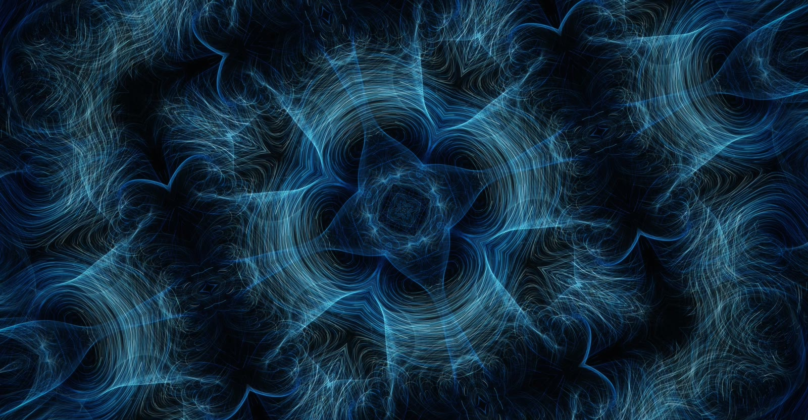

# Flow Lines

Thousands of particles drifting through flow fields, drawn on the GPU, and playing their own music.

**[singhdan.me/flow_lines](https://singhdan.me/flow_lines/)**. Best on a big screen, with sound on.

[](media/demo.mp4)

*Click the picture for a 15 second clip, sound on.*

I made the first version of this in 2024: a 2D canvas, 5,000 particles and one trig formula. It worked, but it wasn't much to look at. In 2026 I asked Claude (Opus 5.5) to rebuild it however it wanted, and kept pushing on the details until it felt right. This is the result.

## Running it

Open the link above, or run it locally. There's no build step and nothing to install:

```bash
python3 -m http.server 8000
```

Then visit http://localhost:8000. Any recent browser with WebGL2 works.

## Things to play with

- **Twelve flow fields**: Marble, Curl Noise, Whirlpools, Magnetic, Orbits, Origin, Stream (wind past drifting obstacles), Silk (rippling ribbons), Waves (interfering ripples), Cells (a turning foam), Galaxy (two spirals) and Smoke (a rising column). Origin is the formula from the 2024 version, still in there.
- **Seven palettes.** Each strand is colored by the direction it's moving.
- **Drag** to pull the fluid along. Hold still while dragging to spin up a vortex.
- **Kaleidoscope**: 2 to 8 fold mirrored symmetry.
- **Mirror**: Book (a Rorschach fold down the middle), Quad, or Prism, a three-mirror kaleidoscope like the toy, which fills the screen with mirrored triangles.
- **Space**: Tunnel (fly down a tube lined with the picture), Tiles (mirrored repeats, so with the kaleidoscope on you get tiles of kaleidoscopes) and Swirl (the middle twists and slowly unwinds). Mirror, Space and the kaleidoscope all combine, and every change cross-fades.
- **Feedback**: the last frame, slightly zoomed and turned, echoes behind the new one, so everything pours into slow spirals.
- **Ripples**: with sound on, notes send rings out through the image from where they ring.
- **Field vectors** (`D`) shows the flow as arrows. They follow the kaleidoscope, mirror and warps too, so they always match what you see.
- **Autopilot**: on by default. It changes fields, palettes, the effects, the motion and the balance of the sound layers on its own random schedule (never your volume), and stirs and scatters the fluid now and then. It never stacks more than two of kaleidoscope, mirror, space and feedback at once. Anything you touch yourself, it leaves alone for 30 seconds. Good as a screensaver.
- **Copy link** saves the exact scene you're looking at, seed included, so someone else sees the same thing.

Every visit starts on a random field and palette.

### Keys

| Key | |
|-----|---|
| `1`–`9` `0` `-` `=` | Field |
| `←` `→` | Palette |
| `Space` | Pause |
| `M` | Sound |
| `A` | Autopilot |
| `K` | Kaleidoscope |
| `V` | Mirror |
| `W` | Space (tunnel, tiles, swirl) |
| `E` | Feedback |
| `X` | Scatter the particles |
| `R` | New seed |
| `D` | Show the field as arrows |
| `C` | Clear the trails |
| `S` | Save a PNG |
| `L` | Copy a link to this scene |
| `F` | Fullscreen |
| `Tab` | Settings panel |
| `H` | Hide everything |

Double-click a slider to reset it. The interface fades out when you stop moving the mouse.

## The sound

Sound is off until you click the speaker (browsers don't allow audio before a click). After that, what you hear comes from what's on screen:

- A soft synth pad holds the chords.
- Small glassy tones come from the bright parts of the image. Height sets the pitch and left/right sets the pan. The more the picture is changing, the more tones there are.
- Bells play a short phrase every so often, and a few notes when the field changes or you scatter.
- The wind: gusts playing strings tuned to the chord, like an aeolian harp. Where the strands flow hard, pressure builds on the strings at that height and releases as soft swells, panned to where the flow is. Calm scenes stay quiet; fast, sweeping ones swell often.
- The palette picks the musical mode, and the kaleidoscope adds echo.

Nothing is prerecorded. It's all synthesized live in the browser with Web Audio.

Claude can't hear, so it used [earshot](https://github.com/Leonxlnx/earshot) to listen to its own renders while designing the sound. It rendered three directions offline, I picked one by ear, and earshot helped track down a harsh organ-like tone I couldn't put a name to. The wind went the same way: the first version read as "white noise" and "vacuum cleaner", a later one as a theremin (I heard a siren), and the one that stayed reads as "a singing bowl" and "soft swelling glass harp tones".

## How it works

Every particle is one pixel in a floating-point texture holding its position, age and seed. Each frame:

1. A shader moves every particle along the flow field.
2. Each particle draws a short anti-aliased line from where it was to where it is, into a trail buffer.
3. Trails fade slowly, which is what makes the lines.
4. A glow pass, tone mapping and color grading turn that into the final image.

A few tricks keep it fast at 4K:

- **Trails fade without touching every pixel.** Instead of darkening the whole buffer each frame, new lines are drawn a little brighter each frame and the final image divides by that growing number. Every few seconds the buffer is rescaled by a power of two so the numbers stay small.
- **The glow is computed at about 540p**, whatever your screen size, so it costs the same at 1080p and 4K.
- **Lines are built in the shader** from instance IDs, with no vertex buffers.
- **Nothing renders** while paused or when the tab is hidden.
- **For the sound**, the GPU shrinks the image to two tiny 32×18 grids, one of light and one of wind (which way the visible strands move, and how much), and the browser reads them back a few frames later so it never has to wait on the GPU.

### Performance

GPU time per frame on a base M1 Mac, rendering at full 4K (3840×2160):

| Particles | Time per frame |
|---|---|
| 16K | ~6 ms |
| 65K (default) | ~8 ms |
| 262K | ~14 ms |
| 1M | ~40 ms |

A 60 Hz screen allows 16.7 ms per frame, so the default leaves plenty of room. It runs at your screen's full refresh rate, with no cap. If your computer can't keep up, it lowers the particle count on its own.

On a laptop, if it suddenly feels stuck at 30 fps, check your battery: Chrome's Energy Saver caps pages at 30 fps when the battery is low.

## Files

| File | |
|---|---|
| `index.html` | The page |
| `style.css` | The interface |
| `js/shaders.js` | All the GPU code, including the twelve fields and the view (kaleidoscope, mirror, space) |
| `js/engine.js` | The WebGL2 rendering pipeline |
| `js/audio.js` | The sound engine |
| `js/app.js` | Settings, controls, autopilot and the main loop |

About 4,450 lines in total, with no libraries.

The browser console has a `flowLines` object if you want to poke at it, e.g. `flowLines.setField('orbit')` or `flowLines.setCount(1048576)`.

## Credits

Built with Claude Opus 5.5 by [Anthropic](https://www.anthropic.com). The sound was checked with [earshot](https://github.com/Leonxlnx/earshot).
